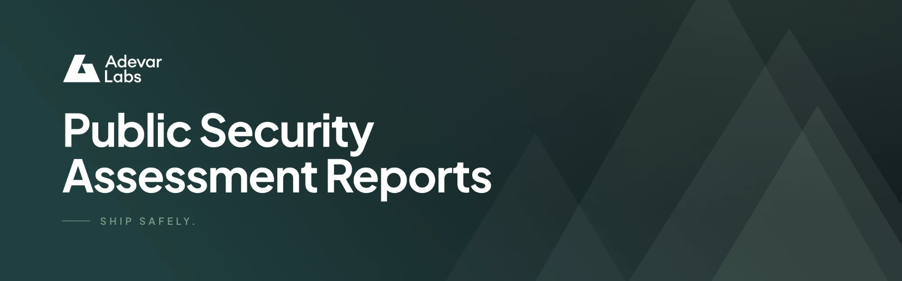
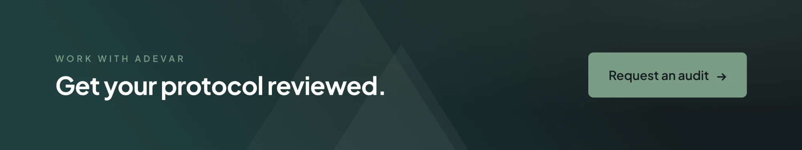

  

This is where we publish the security reviews we've done for our clients, with their permission.

It is only a small part of our work. We've completed more than 100 audits, and most clients choose to keep their reports private, which we fully respect. The reports below are the ones our clients have agreed to share, and we're grateful to those teams for choosing to be open about their security.

## Reports

Newest first. Click a PDF to read the full report.

| Project | Chain | Type | Date | Report |
|---|---|---|---|---|
| Hekaton Agent Vault | Solana | DeFi Vault, Agent Trading | 2026 Aug&nbsp;21 | [PDF](reports/2026-08-21_Hekaton_Agent_Vault_audit_report.pdf) |
| Fystack Apex Backend | Web2 | Backend Infrastructure | 2026 Jun&nbsp;17 | [PDF](reports/2026-06-17_Fystack_Apex_Backend_audit_report.pdf) |
| Crafts Arcium Fundraising Program | Solana | DeFi, Fundraising | 2026 Jun&nbsp;16 | [PDF](reports/2026-06-16_Crafts_Arcium_Fundraising_Program_audit_report.pdf) |
| Spiko Solana Minter | Solana | RWA, Tokenization | 2026 Jun&nbsp;12 | [PDF](reports/2026-06-12_Spiko_Solana_Minter_audit_report.pdf) |
| GLAM Security Enhancements | Solana | DeFi Infrastructure | 2026 Apr&nbsp;7 | [PDF](reports/2026-04-07_GLAM_Security_Enhancements_audit_report.pdf) |
| ORO Protocol | Solana | DeFi, Liquid Staking | 2026 Mar&nbsp;23 | [PDF](reports/2026-03-23_ORO_Protocol_audit_report.pdf) |
| DeGate Solana LP Handler | Solana | DeFi | 2026 Mar&nbsp;20 | [PDF](reports/2026-03-20_DeGate_Solana_LP_Handler_audit_report.pdf) |
| Aspan Finance | EVM BSC | DeFi, Stablecoin, Liquid Staking | 2026 Mar&nbsp;19 | [PDF](reports/2026-03-19_Aspan_Finance_audit_report.pdf) |
| Indentura Vault | Solana | DeFi Vault | 2026 Feb&nbsp;17 | [PDF](reports/2026-02-17_Indentura_Private_Credit_Vault_audit_report.pdf) |
| GLAM SingleAssetVault | Solana | DeFi Infrastructure | 2026 Feb&nbsp;7 | [PDF](reports/2026-02-07_GLAM_SingleAssetVault_audit_report.pdf) |
| M0 Liquidity Delivery | Solana | DeFi Infrastructure | 2026 Jan&nbsp;23 | [PDF](reports/2026-01-23_M0_Liquidity_Delivery_audit_report.pdf) |
| M0 Portal | EVM Solana | DeFi Infrastructure | 2026 Jan&nbsp;21 | [PDF](reports/2026-01-21_M0_Portal_audit_report.pdf) |
| Ignition Stake Pool | Fogo | DeFi | 2026 Jan&nbsp;12 | [PDF](reports/2026-01-12_Ignition_Stake_Pool_Solana_audit_report.pdf) |
| Altura NavVault | Solana | DeFi | 2025 Dec&nbsp;17 | [PDF](reports/2025-12-17_Altura_NavVault_audit_report.pdf) |
| GLAM Integration Patches | Solana | Infrastructure | 2025 Dec&nbsp;15 | [PDF](reports/2025-12-15_GLAM_integration_patches_audit_report.pdf) |
| Pact Governance | Aptos | Governance | 2025 Dec&nbsp;12 | [PDF](reports/2025-12-12_Pact_Governance_audit_report.pdf) |
| Valiant | Fogo | DeFi DEX | 2025 Dec&nbsp;5 | [PDF](reports/2025-12-05_Valiant_audit_report.pdf) |
| DoubleZero Passport Sentinel | Solana | Infrastructure | 2025 Nov&nbsp;18 | [PDF](reports/2025-11-18_DoubleZero_Passport_Sentinel_audit_report.pdf) |
| Carrot Lend Clend Vaults | Solana | DeFi, Lending | 2025 Nov&nbsp;14 | [PDF](reports/2025-11-14_Carrot_Lend_Clend_Vaults_audit_report.pdf) |
| DoubleZero Converter Program | Solana | Infrastructure | 2025 Nov&nbsp;13 | [PDF](reports/2025-11-13_DoubleZero_Converter_Program_audit_report.pdf) |
| DoubleZero Revenue Distribution | Solana | Infrastructure | 2025 Nov&nbsp;12 | [PDF](reports/2025-11-12_DoubleZero_Revenue_Distribution_audit_report.pdf) |
| Trepa Solana Program | Solana | Prediction Markets | 2025 Nov&nbsp;10 | [PDF](reports/2025-11-10_Trepa_audit_report.pdf) |
| GLAM Protocol | Solana | DeFi Infrastructure | 2025 Nov&nbsp;7 | [PDF](reports/2025-11-07_GLAM_audit_report.pdf) |
| Pact Protocol on Aptos | Aptos | DeFi Infrastructure | 2025 Oct&nbsp;20 | [PDF](reports/2025-10-20_Pact_Protocol_on_Aptos_audit_report.pdf) |
| LiFi Zapps | EVM | DeFi Infrastructure | 2025 Oct&nbsp;10 | [PDF](reports/2025-10-10_LiFi_Zapps_VM_audit_report.pdf) |
| Loopscale Periphery Integrations and Upgrades | Solana | DeFi, Lending | 2025 Jul&nbsp;31 | [PDF](reports/2025-07-31_Loopscale_Periphery_Integrations_and_Upgrades.pdf) |
| M0 Extensions | Solana | Stablecoin Infrastructure | 2025 Jul&nbsp;2 | [PDF](reports/2025-07-02_M0_MExtensions_audit_report.pdf) |

Files follow the pattern `YYYY-MM-DD_Project-Name_audit_report.pdf`. Each report reflects the code at the time of review. For a project's current status, check its official channels.

## What's in a report

- **Executive summary.** Scope, the exact contracts, commits or components we reviewed, and a short overview of what we found.
- **Assumptions and considerations.** Trust assumptions and design choices, whether stated by the team or identified by us during the review.
- **Findings.** Every issue we found, rated `Critical`, `High`, `Medium` or `Low`, with a description and a recommended fix.
- **Enhancements.** Improvements with no security impact, such as optimizations and code quality suggestions.

## Disclaimer

Reports are provided "as is" and are limited to the scope and timeline described in each one. A report captures a single point in time and does not guarantee a project's future security. Adevar Labs is not liable for any incidents or losses. An audit is not an endorsement of a project.

## About Adevar Labs

Adevar Labs is a web3 security firm built by researchers. Our engineers have spent years breaking and defending production systems, and we work alongside a bench of independent specialists when an engagement calls for it.

Our core work is white-box code review. We read every line in scope ourselves, with no sampling, and we start each engagement by writing down the threat model: what could go wrong, who could cause it, and which assumptions the code relies on. Fuzzing, formal verification and fix reviews come after that. We work mostly in Rust, Solidity and Move, on Solana, Ethereum, Sui, Aptos, Fogo and other EVM and SVM chains.

Beyond audits, we offer PR reviews and continuous security for teams that ship often, as well as infrastructure, penetration testing and operational security assessments for the parts of a protocol that live outside the contracts.

Adevar Labs is part of the SEAL accreditation program, a Solana STRIDE vendor partner, a Circle Alliance Program partner and a Superteam Black recommended auditor. Our founder holds the ETHSecurity Badge.

[Telegram](https://t.me/adevarlabs) · [X](https://twitter.com/AdevarLabs) · [LinkedIn](https://www.linkedin.com/company/adevarlabs) · [Request an audit](https://www.adevarlabs.com/request-audit)

 

 
 

© Adevar Labs Inc. All rights reserved.

